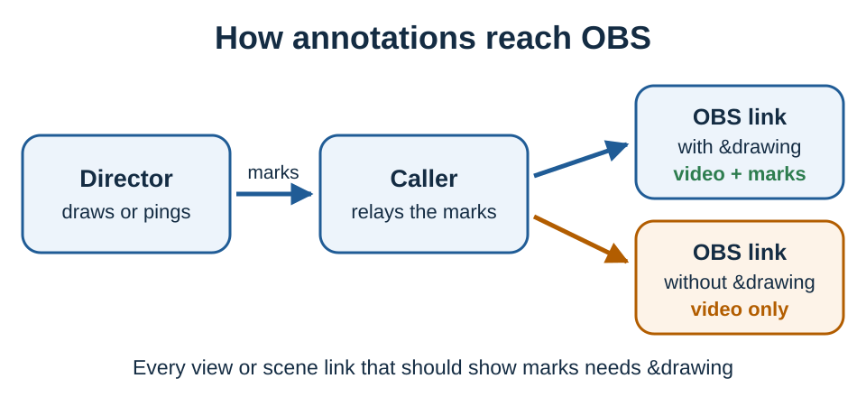

# Telestrate a caller's video

VDO.Ninja's built-in **Draw/Ping on video** tool annotates a caller's camera or screen share. The marks are a synchronized overlay, not part of the caller's encoded video. The caller relays them to other viewers, and each OBS source or viewing link that should show them must include `&drawing`.


**The short version:** Add `&drawing` to the OBS Browser Source URL. In the Director's Room, right-click the caller, select **Request draw access** or **Draw/Ping on video**, then select **Pen**.




## Show the caller and annotations together

For a caller with the stream ID `PLAYER1` in room `YOUR_ROOM`, use this OBS Browser Source URL:

```text
https://vdo.ninja/?view=PLAYER1&room=YOUR_ROOM&drawing&cleanoutput
```

For a complete room scene, add `&drawing` to the scene link:

```text
https://vdo.ninja/?scene&room=YOUR_ROOM&drawing
```

Keep the room password and other connection options the same on the director, caller and OBS links.

## Start drawing

1. In the Director's Room, right-click the caller's video or screen share.
2. Select **Request draw access**. If access was already granted, the option reads **Draw/Ping on video**.
3. The caller gets a chat message asking to allow annotation and selects **Allow**.
4. When the drawing controls appear, select **Pen** and draw over the video.

The controls also include:

* **Ping** for a temporary marker
* a color picker
* **Clear** to remove all marks
* **Undo** to remove the last mark

Right-click the video again and select **Stop draw mode** when finished.

Adding `&drawing` to the caller's invite link pre-approves drawing, so requests are allowed without asking. Only do this when the caller expects annotations.

## Output only the drawings, on a transparent background

Add a separate OBS Browser Source with the same caller link plus `&transparent`:

```text
https://vdo.ninja/?view=PLAYER1&room=YOUR_ROOM&drawing&cleanoutput&transparent
```

In that Browser Source's **Custom CSS** field, use:

```css
video {
    opacity: 0 !important;
}
```

The video stays active as the position reference but is hidden, so only the drawing canvas shows. Place this source above the game feed or other source you want annotated.

Match the Browser Source size and aspect ratio to the feed the telestrator draws on. A different crop or aspect ratio puts the marks in the wrong place.


Every VDO.Ninja view or scene link that should show the annotations needs `&drawing`. Without it, the caller appears normally but the marks don't.


## Troubleshooting

* Refresh the OBS Browser Source after adding `&drawing` or changing its Custom CSS.
* If the director still sees **Request draw access**, the caller hasn't approved yet.
* Don't add `&nodrawingrelay` or `&noshareddrawing` to the caller's link; they stop the caller relaying annotations to other viewers.
* For one caller's feed, use `&view=STREAM_ID`. For a composed room layout, use the scene link with `&drawing`.
