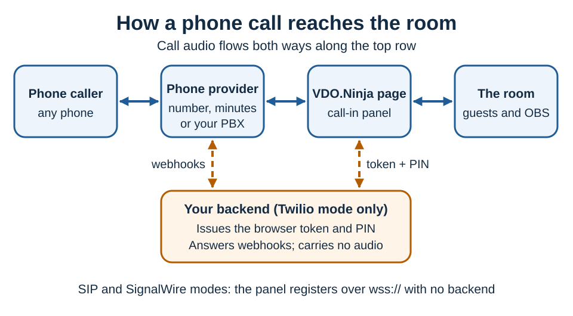

# Twilio phone call-in setup

In Twilio mode, a caller dials your Twilio number, enters a PIN, and reaches the VDO.Ninja page running the call-in panel. Twilio's browser calling needs short-lived tokens, so you also need a backend, such as a Cloudflare Worker, that issues them and answers Twilio's webhooks. Twilio does not work in the panel's SIP mode. For a setup without a backend, see [SignalWire](signalwire-sip-call-in-setup.md).

Audio mixing, mute and Solo Talk behavior, and all URL parameters are covered in [Phone call-in provider options](phone-call-in-provider-options.md).


Keep the Twilio Auth Token and API Key Secret on the backend. Never put them in a VDO.Ninja URL, a web page, or a public repository.




When you click **Start**, the panel gets a token and PIN from your backend and registers with Twilio. Twilio sends each incoming call to your backend's webhook, which connects it to your browser once the caller enters the PIN.

## 1. Collect Twilio credentials

| Value (Twilio Console) | Used for |
| --- | --- |
| Account SID | Token generation and REST API calls |
| Auth Token | Webhook signature validation |
| API Key SID and Secret | Token generation and optional REST API calls. Twilio shows the secret only once. |

## 2. Create a TwiML App

1. Open **Voice** > **TwiML Apps** and create an app.
2. Set the Voice request URL to your backend's incoming-call route, method `POST`, for example `https://YOUR-CALLIN-BACKEND.example.com/twilio/incoming2`.
3. Save, and note the app SID (it starts with `AP`).

## 3. Buy a number and attach it

1. Open **Phone Numbers** > **Buy a number**, choose the country, filter for **Voice**, and buy a number.
2. On the number's configuration page, set voice handling to your TwiML App, and save.

## 4. Configure the backend

A compatible backend uses settings like these:

| Setting | Purpose |
| --- | --- |
| `TWILIO_ACCOUNT_SID` | Account SID |
| `TWILIO_AUTH_TOKEN` | Webhook signature validation |
| `TWILIO_API_KEY_SID` | Voice SDK token issuer |
| `TWILIO_API_KEY_SECRET` | Voice SDK token signing secret |
| `TWILIO_APP_SID` | TwiML App SID |
| `PUBLIC_DIAL_NUMBER` | Phone number shown in the panel |
| `TOKEN_API_KEY` | Optional access key for the session routes |

Validate the `X-Twilio-Signature` header on webhook routes, keep PINs short-lived, rate-limit wrong PINs, and never allow unrestricted outbound dialing.

The panel sends `POST` requests with a JSON body, plus an `X-API-Key` header if you enter an access key:

| Route | Returns or does |
| --- | --- |
| `/session/start` | `token`, `pin` (4 to 10 digits), `identity`, `sessionToken`; optionally `phoneNumber` (E.164) and `outbound: true` |
| `/session/refresh` | A new token for the same PIN, before the old one expires |
| `/session/end` | Ends the session on **Disconnect** or when the page closes |

## 5. Start VDO.Ninja

```
https://vdo.ninja/?director=YourRoomName&callin=twilio&callinapi=https://YOUR-CALLIN-BACKEND.example.com
```

Without `&callinapi`, **Twilio Worker URL** is pre-filled with VDO.Ninja's own test backend. The URL must use HTTPS (or `localhost`). Type any access key into **Worker access key**; it has no URL parameter, so it stays out of shared links.

Click **Start**. The panel shows what to tell your caller, for example:

```
Call +15551234567 and enter PIN 1234567.
```

Calls ring in the panel with **Answer** and **Reject**. Add `&callinautoanswer` to answer automatically. If the backend returns `outbound: true`, **Dial** calls the **Outbound test number** in E.164 format; otherwise **Dial** stays disabled.

## Set up Twilio with the REST API

Steps 2 and 3 can also be scripted. See Twilio's [available numbers](https://www.twilio.com/docs/phone-numbers/api/availablephonenumberlocal-resource) and [incoming numbers](https://www.twilio.com/docs/phone-numbers/api/incomingphonenumber-resource) references.

Search for Canadian local voice numbers:

```bash
curl -G "https://api.twilio.com/2010-04-01/Accounts/ACxxxxxxxxxxxxxxxxxxxxxxxxxxxxxxxx/AvailablePhoneNumbers/CA/Local.json" \
  -u "SKxxxxxxxxxxxxxxxxxxxxxxxxxxxxxxxx:API_KEY_SECRET" \
  --data-urlencode "AreaCode=647" \
  --data-urlencode "VoiceEnabled=true"
```

Set a TwiML App's voice URL:

```bash
curl -X POST "https://api.twilio.com/2010-04-01/Accounts/ACxxxxxxxxxxxxxxxxxxxxxxxxxxxxxxxx/Applications/APxxxxxxxxxxxxxxxxxxxxxxxxxxxxxxxx.json" \
  -u "SKxxxxxxxxxxxxxxxxxxxxxxxxxxxxxxxx:API_KEY_SECRET" \
  --data-urlencode "VoiceUrl=https://YOUR-CALLIN-BACKEND.example.com/twilio/incoming2" \
  --data-urlencode "VoiceMethod=POST"
```

Buy a number and attach it to the TwiML App:

```bash
curl -X POST "https://api.twilio.com/2010-04-01/Accounts/ACxxxxxxxxxxxxxxxxxxxxxxxxxxxxxxxx/IncomingPhoneNumbers.json" \
  -u "SKxxxxxxxxxxxxxxxxxxxxxxxxxxxxxxxx:API_KEY_SECRET" \
  --data-urlencode "PhoneNumber=+15551234567" \
  --data-urlencode "FriendlyName=VDO.Ninja call-in" \
  --data-urlencode "VoiceApplicationSid=APxxxxxxxxxxxxxxxxxxxxxxxxxxxxxxxx" \
  --data-urlencode "VoiceReceiveMode=voice"
```

## Cost

In July 2026, Twilio's pricing API listed a Canadian local number at 1.15 USD per month and inbound calls at 0.0085 USD per minute for one test account. Rates vary by country and change; check [Twilio Voice pricing](https://www.twilio.com/en-us/voice/pricing), and release unused numbers.

## Test and troubleshoot

Click **Start**, call the number from a regular phone, enter the PIN, and then run the [shared test checklist](phone-call-in-provider-options.md#test-before-going-live).

| Symptom | Likely cause |
| --- | --- |
| "Twilio bridge failed: ..." after **Start** | Wrong backend URL or access key, or the backend is missing its secrets. The rest of the message comes from the backend. |
| Twilio reports the application URL failed | The TwiML App's voice URL is wrong, unreachable, or not HTTPS. |
| Calls never reach the browser | The number is not attached to the TwiML App, the PIN expired, or the panel is not registered. |
| Webhooks fail with 403 | The backend rejects Twilio's signatures. Check the Auth Token and the public webhook URL. |
| "Twilio session expired or was rejected." | Click **Disconnect**, then **Start** for a new PIN. |
| The caller hears echo | Someone is playing the call through speakers. Use headphones. |
