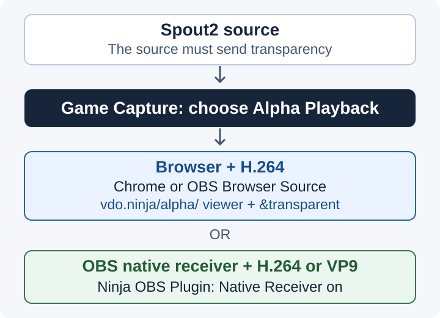

# Using Game Capture and Spout2 with VDO.Ninja

Game Capture is a standalone app for sending a game, app window, camera, or local Spout2 source into VDO.Ninja. The Windows version is the stable release; a Mac version for Apple Silicon is an experimental beta with fewer features.

Game Capture offers hardware encoding and per-window audio for gameplay and app capture.

* [Download Game Capture](https://vdo.ninja/gamecapture)
* [Source code and releases](https://github.com/steveseguin/game-capture)

## Good uses

* Gameplay, esports and remote guests sending one program window.
* Spout2 output from VTube Studio, Warudo, VSeeFace, VNyan and similar avatar apps.
* Transparent VTuber or graphics feeds for a browser, OBS Browser Source, or the Ninja OBS Plugin.
* Shows or recordings where browser screen sharing is not consistent enough.

## Basic workflow

1. On the computer that will publish, open Game Capture.
2. Select the game, app or window to capture, and its audio.
3. Enter a Stream ID or a full VDO.Ninja URL, plus the room and password if you use them.
4. Go live.
5. Add the matching view, solo or scene link to OBS or your production system.

## Publish a Spout2 source

Spout2 shares video between Windows apps on the same computer. Use it to publish a clean avatar or graphics output without the source app's menus.

1. Turn on Spout or Spout2 output in the avatar or graphics app, and keep it running.
2. In Game Capture, set **Video Source** to **Spout2 (avatar apps)**.
3. Select the sender and confirm its preview or size appears.
4. Enter the stream details and go live.

Spout2 carries no audio, so Game Capture switches the **Audio Source** to **No audio** for Spout2. If the feed needs sound, choose **Default output mix**, **Selected microphone/input** or another audio source.

## Choose a transparency method

The source app must send an alpha channel through Spout2. Capturing its window or virtual camera normally loses transparency.

### Browser or OBS Browser Source

Use [Game Capture 0.2.68 or later](https://github.com/steveseguin/game-capture/releases/latest) on Windows.

1. Stop streaming and capture before changing the alpha mode.
2. Select **H.264 (Compatibility)**.
3. Set **Alpha Playback** to **Browser / OBS Browser Source (H.264)**.
4. Turn on **Enable browser alpha (H.264)**. Selecting the playback mode alone does not enable it.
5. Start capture and go live. Copy the generated viewer link.
6. Change the viewer link's base to `https://vdo.ninja/alpha/`, keeping everything from `?` onward. Add `&transparent` and open it in Chrome or an OBS **Browser Source**.

For example, `https://vdo.ninja/?view=YOUR_ID&password=YOUR_PASSWORD` becomes:

`https://vdo.ninja/alpha/?view=YOUR_ID&password=YOUR_PASSWORD&transparent`

Keep your own stream ID, password, and any other query parameters. In OBS, put another source below the Browser Source to see through the transparent areas.

Start at **1280x720, 30 fps**. Browser alpha supports even output dimensions up to **1920x1080 at 60 fps**. Clear custom FFmpeg options for this mode. Hardware H.264 encoding is supported; allow extra bitrate because the stream carries both color and transparency.

[`&transparent`](../advanced-settings/design-parameters/and-transparent.md) clears the page background. Game Capture supplies the video alpha; no `&alpha` viewer flag is needed.

### Ninja OBS Plugin

1. Stop streaming and capture, then set **Alpha Playback** to **OBS native receiver**.
2. Choose **H.264** or **VP9 (OBS Alpha Preview, auto fallback)** and enable the alpha workflow.
3. Start capture and publish.
4. In OBS, add the plugin's **VDO.Ninja Source**, enter the matching stream details, and turn on **Use Native Receiver (Experimental)**.

This mode sends a separate VP9 transparency mask with H.264 or VP9 color video. Its browser viewers receive color video only. Use the Browser playback mode above when you want transparency in a browser or OBS Browser Source.

For plugin installation, see the [Ninja OBS Plugin guide](using-ninja-obs-plugin-with-vdo.ninja.md).

### Chroma key or ordinary video

For a receiver that cannot play alpha, turn alpha off and choose **Alpha Background -> Chroma background** with H.264. Remove that color with a chroma-key filter at the receiver. For ordinary opaque video, leave alpha off.

## Spout2 troubleshooting

* **No senders listed:** turn on Spout output in the source app, keep it running, and select **Refresh** in Game Capture.
* **Sender is black:** set both apps to the same GPU in Windows **Settings -> System -> Display -> Graphics**.
* **No sound:** choose an audio source; Spout2 carries no audio.
* **Alpha option is disabled:** choose the **VDO.Ninja** output and **H.264** video codec for Browser alpha.
* **No video in Browser alpha mode:** use the `/alpha/` viewer URL and confirm the alpha checkbox is on. Older viewers cannot play this mode. Reload or reconnect the viewer if playback stops.
* **Transparent areas are solid:** confirm the source app sends alpha, the alpha checkbox is on, and **Alpha Playback** matches your receiver. Browser viewers cannot composite the native mode's separate mask.
* **Translucent colors look washed out in OBS:** right-click the Browser Source and choose **Blending Method -> SRGB Off**.
* **Low frame rate or high CPU:** lower the resolution or FPS. Try hardware H.264 encoding for the color video.

## Recording and forwarding

For a finished video, compose the Browser Source over your background in OBS and record that scene. A raw browser-alpha stream contains color and its transparency mask side by side; recording or forwarding that raw stream does not produce an ordinary transparent video file.

## Test before a real show

* The selected window captures correctly, with the right audio.
* The receiving OBS source is stable.
* Bitrate and frame rate hold on the real network.
* A short recorded sample plays back cleanly.

## Related


[game-capture.md](../steves-helper-apps/game-capture.md)



[recording-video-with-consistent-results.md](recording-video-with-consistent-results.md)



[how-to-screen-share-in-1080p.md](how-to-screen-share-in-1080p.md)



[how-to-stream-transparent-video.md](how-to-stream-transparent-video.md)



[ninja-obs-plugin.md](../steves-helper-apps/ninja-obs-plugin.md)

