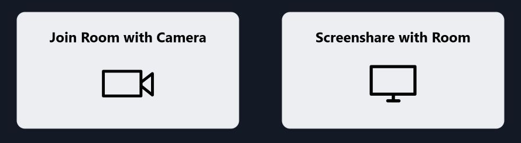
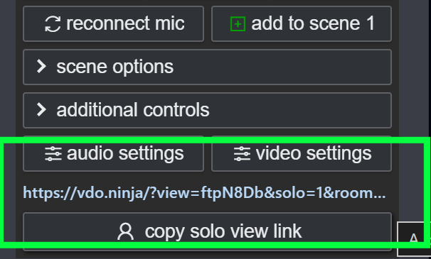
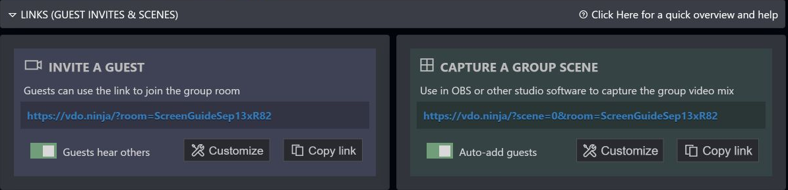
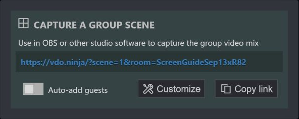

# View-only screen sharing on an iPad or computer

**On a room link, add `&solo` or `&scene` to make it view-only. `&view=STREAMID` alone doesn't skip the join screen in a room.** Viewers don't need a camera or microphone, and OBS isn't required.

## Fix the room link you already have

If your link has `room` and `view`, add `&solo`:

```text
Still asks how to join:  https://vdo.ninja/?room=YOURROOM&view=YOURSCREENID
Opens only that feed:    https://vdo.ninja/?room=YOURROOM&view=YOURSCREENID&solo
```

`&solo` needs no value. `&scene&view=YOURSCREENID` also works. If you only have `?room=YOURROOM`, add `&scene=0` to watch the room's feeds (which can include more than the screen), or use `&scene=1` and have the director add the screen to Scene 1.

Keep any password or access parameters, and put query parameters before any `#` in the URL. A reusable room invite still asks how to join unless the URL selects viewer mode.

<figure><figcaption><p>A room link with view=STREAMID but no solo or scene still presents join choices. The choices shown can vary with device and link options.</p></figcaption></figure>

## Already sharing in a room? Copy the solo view link

1. Go back to the room's director page.
2. Find the control box for the screen share (not the webcam, if you have both).
3. Click **copy solo view link** at the bottom of that box.
4. Open the copied link in the viewer's browser.

<figure><figcaption><p>Look at the bottom of the screen-share feed's control box, below audio settings and video settings. Click copy solo view link in the green-highlighted area. The generated URL already includes solo=1, which selects solo viewer mode.</p></figcaption></figure>

Send the full link, including any password or access parameters. The guest invitation and the director page address are not the screen's viewing link. Solo links work in any browser, not only in OBS. See [Rooms and solo links](../getting-started/rooms/README.md).

<figure><figcaption><p>The top-level Copy link buttons have different purposes. Capture a Group Scene provides a viewing link that also works in an ordinary browser.</p></figcaption></figure>

## Simplest reusable setup: two links, no room

For one screen that others only watch, skip the room. Pick a hard-to-guess stream ID and use exactly the same value in both links.

**On the computer sharing its screen:**

```text
https://vdo.ninja/?push=YOURSCREENID&screenshare
```

Choose the screen, window or tab and approve the browser's prompt.

**For the people watching:**

```text
https://vdo.ninja/?view=YOURSCREENID
```

Bookmark both. Each time, open the publishing link and start sharing again; viewers reuse their link. Only one device should publish with that ID at a time. The link doesn't keep the screen broadcasting after you close the page or stop sharing, and the browser asks for screen-capture approval every session.

If the sender shares audio, viewers hear it too. On an iPad or some browsers, tap the page's play/unmute prompt; that doesn't require a microphone.

## Reusable viewing links within a room

Use matching room and stream IDs:

```text
Sharing computer: https://vdo.ninja/?room=YOURROOM&push=YOURSCREENID&screenshare
Viewer:           https://vdo.ninja/?room=YOURROOM&view=YOURSCREENID&solo
```

Keep the same password or access settings in both. A room viewer link only finds publishers in that same room, so the sharing computer must join the room too; a standalone `?push=` link won't appear. A screen share added alongside a webcam can have its own stream ID, so copy its actual solo view link rather than guessing.

You can also give viewers a scene link and choose the feed from the director page:

```text
https://vdo.ninja/?room=YOURROOM&scene=1
```

Add the screen share to **Scene 1** at the start of each session. To get this link, turn off **Auto-add guests** in the **Capture a Group Scene** panel, then click **Copy link**. `&scene=0` includes the room's video feeds automatically, so use Scene 1 or a solo link when viewers should see only the screen.

<figure><figcaption><p>With Auto-add guests off, the copied link uses Scene 1. Add the screen-share feed to that scene so viewers have something to watch.</p></figcaption></figure>

## Quick troubleshooting

| What you see | What to check |
| --- | --- |
| Camera / audio-only join choices | On a room link, add `&solo` with `&view=YOURSCREENID`, or use `&scene`. |
| A blank or waiting viewer | The sender is sharing, and both links use the same stream ID, room and password. |
| An empty Scene 1 | Add the screen-share feed to Scene 1 in the director page. |
| The webcam instead of the screen | Copy the screen share's own solo view link. |
| Video but no sound | Tap play/unmute if prompted; check the sender included audio in the browser's sharing dialog. |

## Related guides

* [Permanent links, reusable invites, and stream IDs](how-to-get-permanent-links.md)
* [Screen-sharing options](../source-settings/screenshare.md)
* [View links](../advanced-settings/view-parameters/view.md)
* [Room scenes](../advanced-settings/view-parameters/scene.md)
