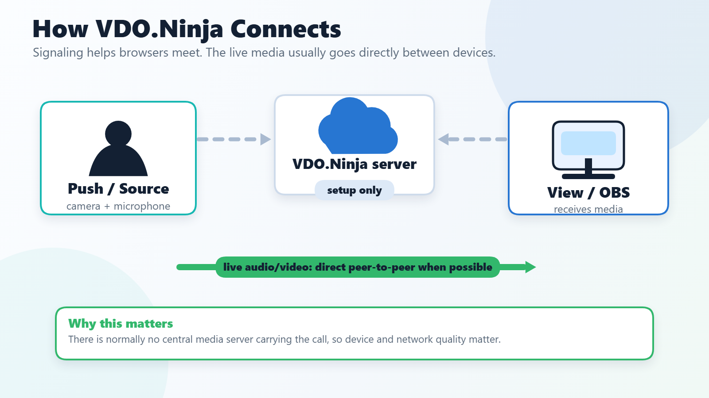
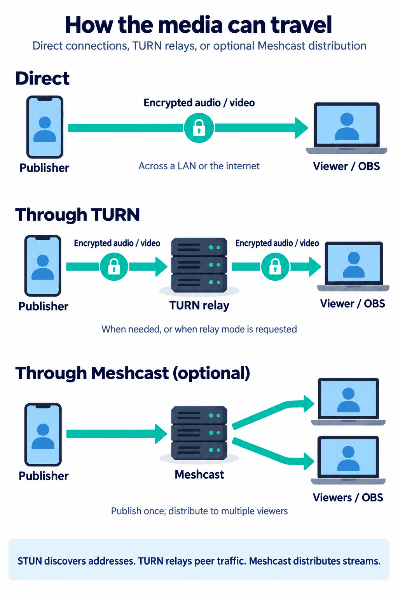

# How does it work

VDO.Ninja sends audio and video directly between the devices in a session using WebRTC, a technology built into every modern browser. The website only delivers the app to each browser, and the VDO.Ninja handshake server only helps the devices find each other and exchange connection details. Neither one carries the live stream.

Because the media goes device to device, two devices on the same local network usually keep the stream on that network, even when the page itself was loaded from vdo.ninja. Loading the page and completing the handshake still need internet access, so a network with no internet at all needs the [offline deployment](#local-networks-without-internet) described below.

<figure><figcaption>
VDO.Ninja servers help peers find each other, but the live audio and video usually travel directly between browsers.
</figcaption></figure>

## The moving parts

| Part | What it does |
| --- | --- |
| **Website (HTTPS)** | Loads the interface and JavaScript that run on your device. Serving these files does not relay the stream. |
| **Signaling / handshake (WSS)** | Helps peers find each other and exchange connection details. It normally stays connected for room activity, new viewers, and reconnection, but it does not carry the audio or video. |
| **WebRTC** | The browser technology that captures, encrypts, sends, and plays real-time audio, video, and data between connected peers. |
| **STUN** | Helps a device learn its address as seen from outside its local network. A STUN server does not forward the media. |
| **TURN** | Relays the encrypted media when a direct route is not possible, or when relay mode is requested. It forwards packets without decoding the audio or video. |
| **Meshcast (optional)** | A media server, often called an SFU (selective forwarding unit), that receives one published stream and distributes it to many viewers. This reduces the publisher's upload load. |

## Where the media travels

<figure><figcaption>
Direct, relayed through TURN, or distributed by Meshcast. The stream stays encrypted between the peers on the direct and TURN paths.
</figcaption></figure>

WebRTC's ICE connection checks pick a working route from the available addresses and relays. Discovery and checks overlap, so this is not a fixed sequence of separate LAN, STUN, and TURN attempts. If a relay is being used when you did not expect one, see [Relay candidate being selected](../common-errors-and-known-issues/relay-candidate-being-selected.md). You can also [host your own TURN server](../common-errors-and-known-issues/hosted-your-own-turn-server.md).

Ordinary rooms use peer connections: a publisher may send a separate copy of its stream to each receiving peer, so more viewers can mean more upload bandwidth and more load on the publishing device. A director's room coordinates the participants; it does not mix everyone's video on a server.

With optional [Meshcast](../steves-helper-apps/meshcast.io.md), the publisher sends one stream to Meshcast, which distributes it to the viewers. Meshcast is enabled separately with [`&meshcast`](../newly-added-parameters/and-meshcast.md); VDO.Ninja does not switch a peer-to-peer session to Meshcast on its own. WHIP/WHEP and other SFU setups can also use server-based media paths.

## Local networks without internet

On a normal private network, VDO.Ninja works as long as every device can reach the internet to load the page and complete the handshake. The media itself usually stays on the local network. If the network has no internet access at all, the hosted site cannot load, so use the [offline deployment](https://github.com/steveseguin/offline_deployment), which bundles the website with a local handshake server. HTTPS is still required for phones and other remote clients, so that guide also covers certificates.

## Push and view links

VDO.Ninja's core functionality revolves around two types of URLs:

* **Push link:** opened on the sending device (your smartphone, webcam, etc.) to capture and transmit the video and audio.
* **View link:** opened on any device, anywhere, to watch the live stream in a clean, full-screen interface, including as an OBS Browser Source.

## Rooms

Beyond basic streaming, VDO.Ninja offers group chat rooms, giving you more control and flexibility when working with multiple streams simultaneously. You can manage participants, adjust settings, and even create custom layouts, all within your browser.

## URL parameters: your control center

VDO.Ninja uses URL parameters to fine-tune your streaming experience. These parameters act like commands, allowing you to adjust video quality, enable features, and much more. Think of them as similar to command-line options you might use with software like FFmpeg.

## Ready to dive deeper?

While VDO.Ninja's default settings are designed to be user-friendly, its extensive feature set offers endless possibilities. Explore the rest of the documentation to discover the advanced options.
