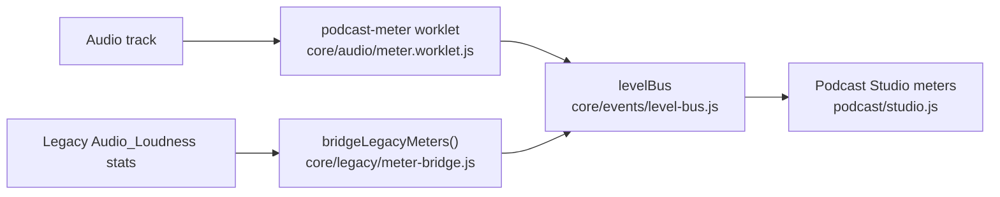

# Audio Meter Pipeline Spec

Podcast Studio needs per-track levels that do not depend on the main app's DOM meters. This page describes the legacy meters, what is now built in `core/`, and what is still missing.

## Legacy meters (`lib.js`)

- `audioMeterGuest(mediaStreamSource, UUID, trackid)` adds an `AnalyserNode` to `session.rpcs[UUID].inboundAudioPipeline[trackid]`.
- Every 100 ms it averages the FFT bins into a loudness value (`stats.Audio_Loudness`) and draws the `voiceMeter` element, in the style chosen by `session.meterStyle`.
- The loop also posts loudness to the IFRAME parent when `session.pushLoudness` is on, and the loudness stats feed the active-speaker features.
- Audio analysis and DOM updates share one loop.

## Current implementation (`core/`)

- **Worklet:** `core/audio/meter.worklet.js` registers `podcast-meter`. About every 32 ms it posts the peak (largest absolute sample), the RMS and a clipped-sample count (samples at or above 0.89, about -1 dBFS), with `silent` set when RMS is at or below 0.001 (-60 dBFS).
- **Helper:** `monitorTrackLevel(audioContext, track, { uuid, trackType, metadata })` in `core/audio/meters.js` connects a track to the worklet and an analyser, and returns `disconnect()`.
- **Event bus:** `levelBus` emits `level` for every reading, plus `clip` when samples clipped and `silence` when the reading is silent. Payloads carry `uuid`, `trackType`, `metadata`, `peak`, `rms`, `clipped`, `silent` and `timestamp`.
- **Legacy bridge:** `bridgeLegacyMeters()` polls `stats.Audio_Loudness` for the local stream and each peer every 120 ms and publishes normalized `level` events with `source: 'legacy-meter'`. It reads the legacy stats and does not change `audioMeterGuest()`.
- **Users:** Podcast Studio meters the host microphone and every track recorded by `MultiTrackRecorder` with the worklet, starts the legacy bridge, and draws its meters from `level` events.

## Still to do

- **Alerts:** nothing subscribes to `clip` or `silence` yet. The planned rules were a clip alert after three consecutive clipped readings, a silence alert after more than 3 seconds of silence, and per-room overrides (`LevelPolicy`, not built).
- **Recording markers:** let the recording service add markers on clip or silence.
- **Legacy decoupling:** move the main app's `voiceMeter` updates onto `levelBus` so analysis and DOM updates are separate.
