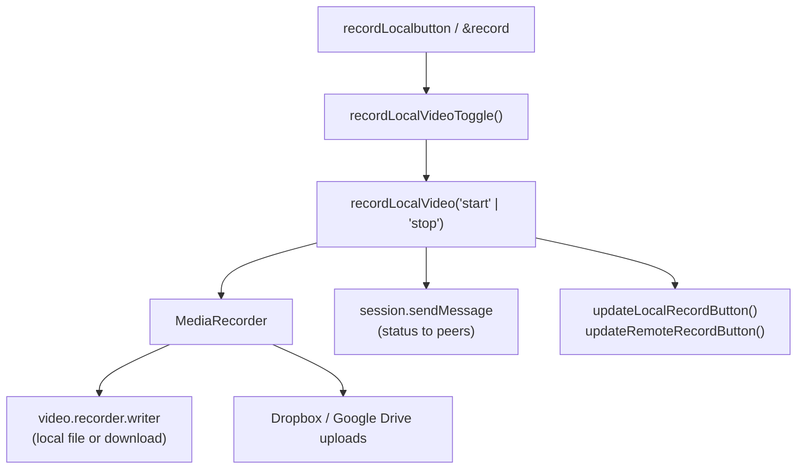

# Recording Flow Map

How recording works in the main app and in Podcast Studio (`&podcast`). Line numbers change often, so search for the function names below.

## Main app recording (`lib.js`)

1. The record button (`recordLocalbutton` in `index.html`) calls `recordLocalVideoToggle(startonly)`. In `main.js`, `&record=<kbps>` sets the bitrate (`session.recordLocal`) and `&record=false` or `off` hides the record buttons.
2. `recordLocalVideoToggle()` updates the button and calls `recordLocalVideo("start")` or `recordLocalVideo("stop")`.
3. `recordLocalVideo(action, configureRecording, remote, altUUID)` records the video element's stream with a `MediaRecorder` (`video.recorder.mediaRecorder`) and writes the chunks through `video.recorder.writer` or a download.
4. If cloud storage is linked, the chunks also go to Dropbox (`streamVideoToDropbox()`, local streams only) and Google Drive (`setupGoogleDriveUploader()`, which returns an object with `addChunk`).
5. Status messages go to other peers, such as the director, through `session.sendMessage`. `updateLocalRecordButton()` and `updateRemoteRecordButton()` update the buttons.

`&autorecord` and `&autorecordremote` record incoming videos with the same function, or with `recordVideo()` on a director page.

Each recorder captures one video element's combined audio and video, so it cannot save separate audio tracks, and the local recorder's state is tied to the button.

`&chunked` mode is separate and is not a recording path. `session.webCodec()` and `session.webCodecAudio()` in `webrtc.js` encode frames, and `session.chunkedRecorder.sendChunks()` sends them to viewers over peer data channels (`session.chunkedTransferChannels`).

## Podcast Studio recording (`core/recording`)

Podcast Studio (`podcast/studio.js`) uses `MultiTrackRecorder` from `core/recording/multitrack-recorder.js`, set up for audio only:

- It records the local stream (`session.streamSrc`) and each remote peer's stream (`session.rpcs[UUID]`) as separate tracks, each with its own `TrackRecorder` (`core/recording/track-recorder.js`).
- With `monitorLevels`, each recorded track also gets a level meter (see [audio-metering.md](audio-metering.md)).
- `packageAudioFiles()` converts each track to WAV with `convertBlobToWav()` (`core/recording/wav-encoder.js`) and keeps the original file if conversion fails.

## Podcast Studio audio recovery

While recording, Podcast Studio saves each audio track's encoded chunks, name, start time and cue markers to IndexedDB (`podcast/audio-recovery.js`). Reconnected tracks are saved as separate segments.

To recover a take, reopen the studio in the same browser, expand **Saved audio** under **Timeline & Outputs**, select the take and choose **Prepare download**. Each track offers its original audio and, when conversion succeeds, a WAV file. Copies stay until you select **Clear saved audio** or clear browser data. Interrupted takes may be incomplete. Storage failures appear in the studio; if one appears, stop and download the normal recordings before closing the tab.
