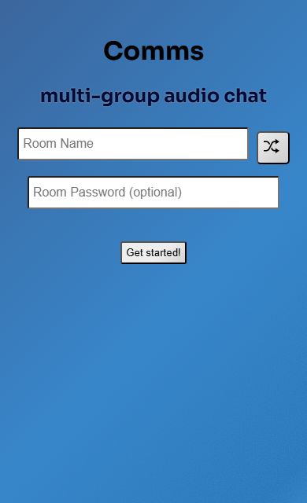
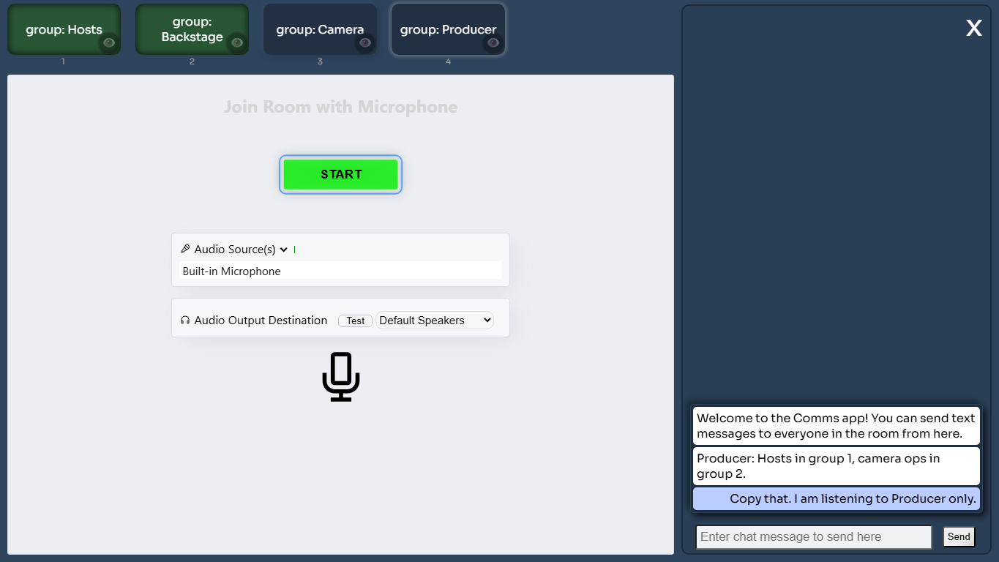
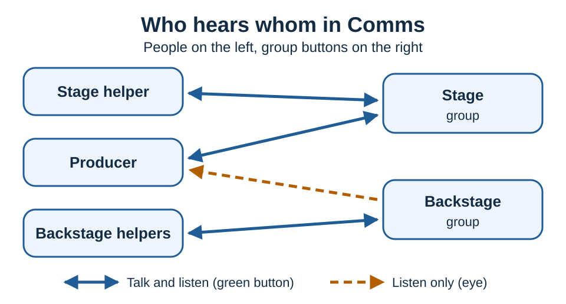
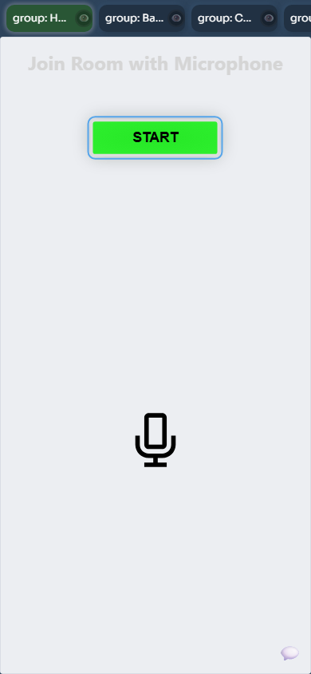

# Comms

Comms is a browser-based intercom built on VDO.Ninja. It works like several walkie-talkie channels in one web page: everyone joins the same room, but each person only hears the groups they choose. Open [https://comms.cam/](https://comms.cam/) or [https://vdo.ninja/comms.html](https://vdo.ninja/comms.html).

Use it for private production audio that stays separate from the show: a producer talking to hosts or camera operators, a guest waiting backstage before going on air, or helpers coordinating from their phones while OBS, Zoom, or YouTube runs the public show. Nothing needs to be installed. Comms does not replace a normal VDO.Ninja guest room for the program video.

## Quick start

1. Open [https://comms.cam/](https://comms.cam/).
2. Enter a unique room name. Add a room password if the room should be private.
3. Select **Get started!**.
4. Allow microphone access when the browser asks.
5. Select **START** in the VDO.Ninja audio panel.
6. Click or tap the group you want to talk with.

<figure><figcaption><p>Mobile start screen: enter a room name, optionally add a password, then tap Get started.</p></figcaption></figure>

Everyone who should talk together needs the same room name and password. The simplest setup is to send everyone the same link and tell them which group to select.

## How the groups work

| What you do | What happens |
| --- | --- |
| Click a group button | You talk and listen in that group. The button turns green. |
| Click more than one group | You talk and listen in all of those groups. |
| Click the eye on a group | You listen to that group without your microphone going into it. |
| Click a green group again | You leave that group. |
| Press a number key (desktop) | Toggles the matching group button: 1 for the first, 2 for the second, and so on. |
| Ctrl+click (Command+click on Mac) a group name | Gives the group a custom label. |

You hear people talking in the groups you joined or turned the eye on for. You are heard only in the groups you joined. Comms turns on strict group routing, so until you select a group, you hear no one and no one hears you.

<figure><figcaption><p>Desktop room view: group buttons are on top, the microphone setup is in the middle, and room chat is on the right.</p></figcaption></figure>

## Example: a school concert stream

You have a producer at the laptop, a stage helper with a phone near the performers, and some backstage helpers. Use two groups:

```text
https://comms.cam/?room=ConcertComms&groups=Stage,Backstage
```

* The **producer** clicks `Stage` to talk with the stage helper, and clicks the eye on `Backstage` to listen there without interrupting.
* The **stage helper** clicks only `Stage`. They hear the producer, but not the backstage conversation.
* The **backstage helpers** click `Backstage`. They talk among themselves, and the producer can listen in.



## Mobile use

On phones and small windows, the group buttons scroll sideways at the top, and chat moves behind a chat button.

<figure><figcaption><p>Mobile room view: swipe the group buttons left or right, then tap START to enable the microphone.</p></figcaption></figure>

* Use headphones or earbuds to avoid echo.
* Keep the tab open and the phone unlocked. Safari on iPhone and iPad may stop capturing audio when the page is not active. On Android, Chrome is usually the safest choice.
* If the buttons feel cramped, rotate the phone or add `&mobile` to force the mobile layout.

## Text chat

Chat goes to everyone in the room, not only your group. Add `&hidechat` to hide it.

## Prepared links

```text
https://comms.cam/?room=ShowComms
https://comms.cam/?room=ShowComms&password=secret123
https://comms.cam/?room=ShowComms&groups=Hosts,Backstage,Camera,Producer
https://comms.cam/?room=ShowComms&groups=Hosts,Backstage,Camera,Producer&groupview=Producer
https://vdo.ninja/comms.html?room=ShowComms&groups=Hosts,Backstage,Camera,Producer
```

The fourth link starts with the eye on for `Producer`. The last one opens the same app from vdo.ninja.

## URL options

| Option | Alias | What it does |
| --- | --- | --- |
| `&room=ShowComms` | `&r` | Sets the room name |
| `&password=secret123` | `&pw`, `&pass`, `&p` | Sets the room password |
| `&groups=Hosts,Backstage,Camera` | `&group` | Sets the group buttons. Without it, Comms shows the groups saved in this browser, or groups 1 to 6. |
| `&groupview=Producer` | `&gv` | Starts listening to these groups without talking into them |
| `&label=Producer` | `&l` | Sets your display name |
| `&push=producer-comms` | `&sid` | Sets a stable VDO.Ninja stream ID |
| `&hidechat` | | Hides the chat panel |
| `&mobile` | | Forces the mobile layout |
| `&video` | | Turns on the camera. In the current version, it also turns off the microphone. |
| `&api=ID` | `&osc` | Passes an API/OSC ID to the embedded VDO.Ninja session |

Behind the scenes, Comms uses VDO.Ninja's [`&group`](../general-settings/and-group.md), strict [`&groupmode`](../advanced-settings/setup-parameters/and-groupmode.md), and [`&groupview`](../advanced-settings/setup-parameters/and-groupview.md) options.

## Room memory and security

Comms remembers your last room, password, and group setup in this browser's local storage, which is why **Restore last room** may appear. It does not sync to other devices.

Use a unique room name and a password for real productions. Anyone with both can try to join, so treat the link like a backstage pass.

## Troubleshooting

| Problem | Check |
| --- | --- |
| Nobody hears you | You selected **START**, the browser has microphone permission, a group button is green, and your microphone is not muted. Remove `&video`, which turns the microphone off. |
| You hear the wrong people | Which buttons are green, which groups have the eye on, and that everyone uses the same room name and password |
| Mobile audio stops | Keep the tab visible and the phone awake, try headphones, and use Chrome on Android or Safari on iOS |

## Related


[room.md](../general-settings/room.md)



[and-password.md](../advanced-settings/setup-parameters/and-password.md)



[and-group.md](../general-settings/and-group.md)



[and-groupview.md](../advanced-settings/setup-parameters/and-groupview.md)



[and-groupmode.md](../advanced-settings/setup-parameters/and-groupmode.md)



[push.md](../source-settings/push.md)



[label.md](../general-settings/label.md)



[updates-comms.md](../updates/updates-comms.md)

