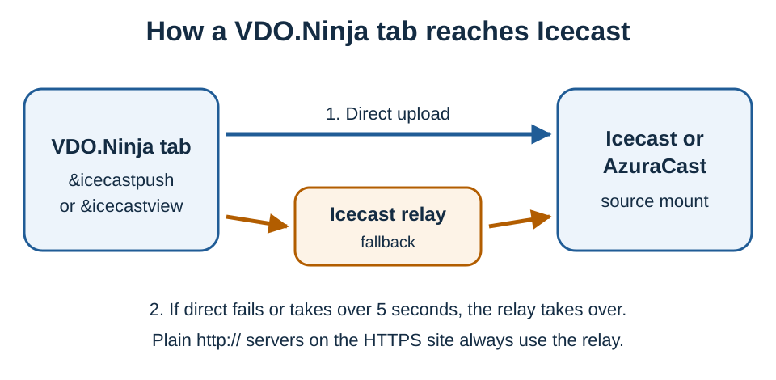

# Icecast and AzuraCast audio publishing

A VDO.Ninja tab can act as a source client for an Icecast-compatible radio server, such as Icecast or AzuraCast. Keep that tab open for the whole broadcast; closing it stops the stream.

The setup helper builds the link for you:


[https://vdo.ninja/icecast](https://vdo.ninja/icecast)


The alpha helper is here:


[https://vdo.ninja/alpha/icecast](https://vdo.ninja/alpha/icecast)


There are two modes:

* **Publish local audio** (`&push` + `&icecastpush`): the tab captures its own microphone or audio source and sends it to Icecast.
* **Relay an existing stream** (`&view` + `&icecastview`): the tab receives a VDO.Ninja stream that is already live elsewhere and forwards its audio to Icecast.

## Basic workflow

1. Open [vdo.ninja/icecast](https://vdo.ninja/icecast).
2. Leave **Publishing mode** on **Publish local audio with \&push** and enter a stream ID, such as `FUSION_ONLINE`.
3. Enter your Icecast or AzuraCast source details: **Source URL / server**, **Mountpoint**, **Username** and **Password**. Use the source (ingest) endpoint, not the public listener URL.
4. Click **Generate**, then **Open**. The link opens in a new tab.

The generated link looks like this:

`https://vdo.ninja/?push=FUSION_ONLINE&audioonly&proaudio&icecastpush&icecastauto=1`

With **Save source credentials in this browser** checked (the default), the password is stored in this browser and stays out of the link. To use the link on another computer, check **Include source credentials in the generated URL** and treat the link like a password.

If auto-start is off or settings are missing, use the **Icecast / AzuraCast** panel on the VDO.Ninja page: **Settings**, **Start Icecast** and **Stop**.

## Relay an existing stream

If the audio already goes into VDO.Ninja from another browser, choose **Relay an existing VDO.Ninja stream with \&view**. This makes a second tab that receives the stream and forwards it:

`https://vdo.ninja/?view=FUSION_ONLINE&novideo&proaudio&icecastview&icecastauto=1`

## AzuraCast

AzuraCast works when the station offers an Icecast-compatible source mount. Copy the station's source connection details (username, password, host and port, and mountpoint) from the station profile.

Do not use the public listener URL, such as a `/listen/` URL; VDO.Ninja rejects it. A bare IP address with no port or path is also rejected; include the port or the AzuraCast ingest path.

## Audio format

AAC (`audio/aac`) is the default. If the browser cannot encode AAC, VDO.Ninja falls back to a WebM or Ogg format the browser can record. You can also choose WebM Opus or Ogg Opus directly. Your Icecast or AzuraCast mount must accept the format you send.

## Direct upload and the relay

Browsers can only upload directly to servers that allow it: the server must be reachable over HTTPS (from the HTTPS VDO.Ninja site) and accept browser (CORS) uploads. To cover the rest, VDO.Ninja tries a direct upload first and switches to its Icecast relay if the direct upload fails or does not connect within 5 seconds. An `http://` source URL opened from the HTTPS site goes straight to the relay.

* `&icecastrelay=0` (or `false`, `off`, `no`, `direct`, `none`) disables the relay. Use it only when direct upload works.
* With the relay, the source URL must use a hostname, not an IPv4 address.

## URL parameters

Use an explicit mode flag. `&icecastpush` and `&icecastview` together are treated as ambiguous. The older `&icecast` / `&icecastout` flags pick the mode from `&push` or `&view`, and are ambiguous in room links, which can have both local and incoming audio.

| Parameter | Aliases | Purpose |
| --- | --- | --- |
| `&icecastpush` | `&icecastlocal`, `&icecastmic` | Publish this tab's own audio. Use with `&push`. |
| `&icecastview` | `&icecastremote`, `&icecastfromview` | Publish received audio. Use with `&view`, `&scene` or a receive-only tab. |
| `&icecastauto=1` | `&icecastautostart` | Start automatically once audio is available and settings are complete. |
| `&icecasttarget=` | `&icecasturl`, `&icecastsource` | Full source URL, including the mountpoint. |
| `&icecastserver=` | `&icecasthost` | Server URL, combined with `&icecastmount`. |
| `&icecastmount=` | `&icecastmountpoint` | Mountpoint added to `&icecastserver`. |
| `&icecastuser=` | `&icecastusername` | Source username. Default: `source`. |
| `&icecastpassword=` | `&icecastpass`, `&icecastsourcepassword` | Source password. |
| `&icecastformat=` | `&icecastmime`, `&icecasttype` | `audio/aac` (default), `audio/ogg;codecs=opus` or `audio/webm;codecs=opus`. Short forms `aac`, `opus`, `ogg` also work. |
| `&icecastbitrate=` | `&icecastab` | Bitrate in bits per second or kbps, such as `128000` or `128`. Default: 128 kbps. |
| `&icecastname=` |  | Stream name. Default: `VDO.Ninja Live`. |
| `&icecastgenre=` |  | Genre. Default: `Live`. |
| `&icecastdescription=` | `&icecastdesc` | Description. |
| `&icecastpublic=1` |  | Mark the stream as public in Icecast metadata. |
| `&icecastrelay=` | `&icecastrelayurl` | Custom relay URL, or `0` to disable the relay. |
| `&icecastrelaytoken=` |  | Token for a private relay. |
| `&icecaststream=` | `&icecastsid` | In relay mode, which received stream ID to publish when the tab receives several. |

## URL examples

Source URL and password in the link:

`https://vdo.ninja/?push=FUSION_ONLINE&audioonly&proaudio&icecastpush&icecasttarget=https%3A%2F%2Fradio.example.com%3A8000%2Fstream&icecastuser=source&icecastpassword=SOURCE_PASSWORD&icecastauto=1`

Server and mount given separately:

`https://vdo.ninja/?push=FUSION_ONLINE&audioonly&proaudio&icecastpush&icecastserver=https%3A%2F%2Fradio.example.com%3A8000%2F&icecastmount=stream&icecastpassword=SOURCE_PASSWORD`

Direct upload only, without the relay:

`https://vdo.ninja/?push=FUSION_ONLINE&audioonly&proaudio&icecastpush&icecastrelay=0&icecasttarget=https%3A%2F%2Fradio.example.com%3A8000%2Fstream&icecastpassword=SOURCE_PASSWORD`

## Troubleshooting

* **Waiting for local VDO.Ninja audio...** (or **Waiting for received VDO.Ninja audio...** in relay mode): check that the microphone or source is active. In relay mode, also check that the sender is live and the `&view=` stream ID is correct.
* **Icecast rejected the stream**: check the source URL, username, password, mountpoint and accepted audio format.
* **AzuraCast**: copy the source connection details from the station profile, not the public listening link.
