# VDO.Ninja native mobile app guide

The VDO.Ninja native apps turn a phone or tablet into a capture device. Use them when the browser cannot do what you need: Android USB cameras and HDMI adapters, mobile screen sharing, USB audio, local recording, WHIP publishing, producer talkback, Social Stream Ninja chat while filming, camera controls, or optional experimental RTMP/SRT output. The web version at [https://vdo.ninja](https://vdo.ninja) remains the most flexible director, viewer, and control surface.

Updated October 2, 2026. Available controls depend on the installed app version, device, and capture mode. Older builds may show **Prefer 1080p** where newer builds have separate camera or screen-share quality menus. Check the store's version history if a control described here is missing.


Android app



iOS app


<figure>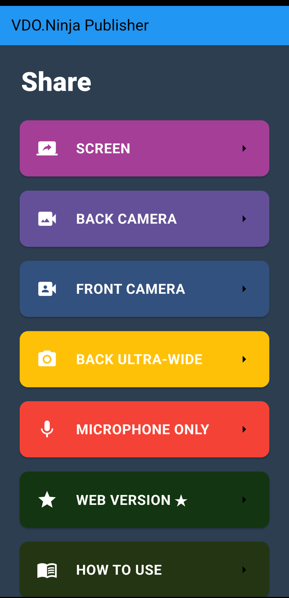<figcaption><p>The available capture modes depend on the device, platform, connected cameras, and connected audio devices.</p></figcaption></figure>

<figure>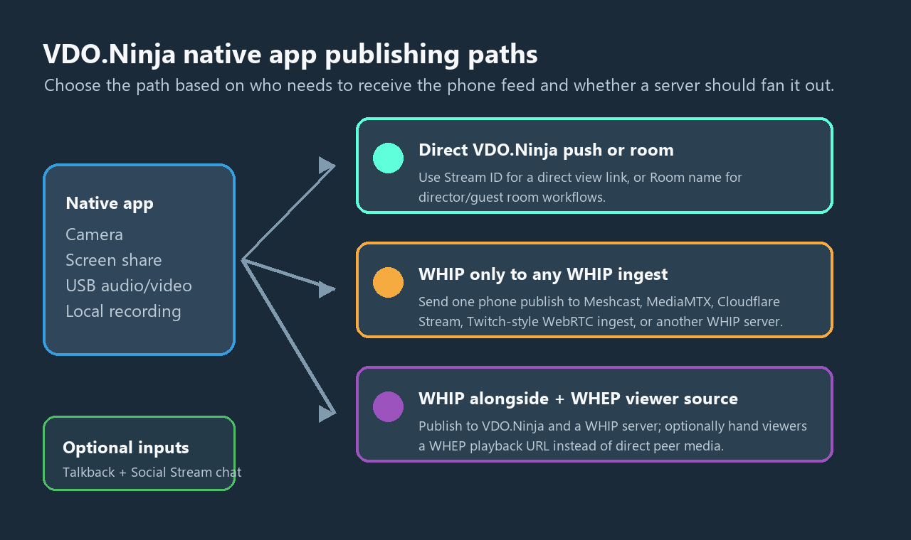<figcaption><p>Publishing options depend on capture mode. Native iOS screen sharing uses its generated viewer link or configured WHIP destination; its direct publishing path does not join rooms.</p></figcaption></figure>

## Quick start

1. Open the app and choose a capture mode, such as **BACK CAMERA**, **SCREEN**, **USB CAMERA**, or **MICROPHONE ONLY**.
2. Enter a **Stream ID** for a stable push/view link, or leave it blank to have the app generate one.
3. Enter a **Room name** if the selected mode supports rooms and you want to join a director session. For native iOS screen sharing, use the generated viewer link instead.
4. Enter a **Password** if the room or stream is password protected.
5. Select the microphone. If you plug in USB audio after opening the screen, tap **Refresh Mics**.
6. Tap the connect button and accept the permissions that Android or iOS requests.

<figure>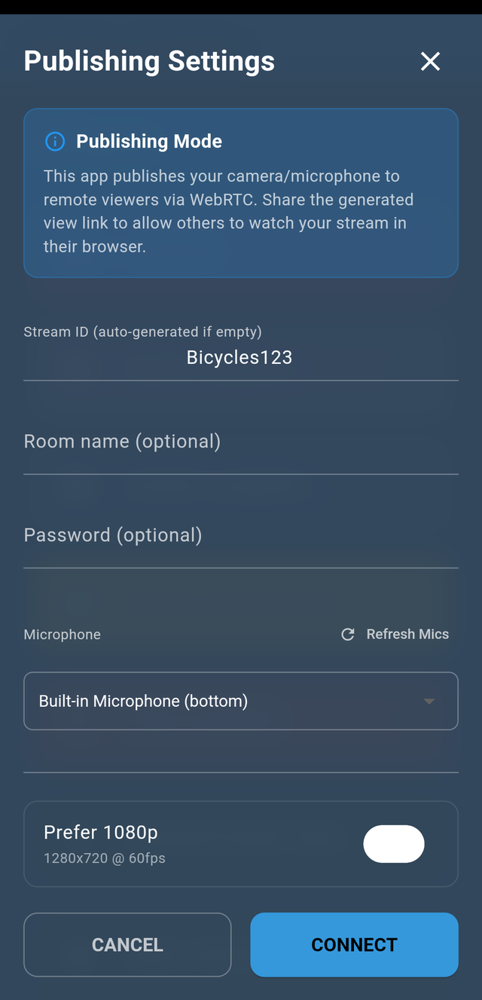<figcaption><p>Publishing Settings is where you choose the VDO.Ninja stream, room, microphone, quality mode, and advanced options.</p></figcaption></figure>

| Fill in | Use it for | Open on the receiving side |
| --- | --- | --- |
| **Stream ID** `mycamera` | A phone camera for OBS, vMix, or a browser | `https://vdo.ninja/?view=mycamera` |
| **Room name** `myroom` | A room where a director manages guests, scenes, layouts, and recording | `https://vdo.ninja/?director=myroom` |
| Both: `widecam` in `myroom` | A room participant with a predictable source ID, for fixed camera positions and event templates | `https://vdo.ninja/?director=myroom` |

The native iOS ReplayKit screen-sharing publisher does not join rooms. A room name does not turn its direct screen-share feed into a room participant. Use the viewer link shown by the app for that mode.

## Capture modes

| Mode | Use it for |
| --- | --- |
| **BACK CAMERA** | The main rear camera; the normal phone-as-camera mode |
| **FRONT CAMERA** | Selfie capture, talkback, or a presenter-facing view |
| **BACK ULTRA-WIDE** and other lenses | Room views and wide shots, when the device exposes them |
| **USB CAMERA** | Android only: UVC cameras and HDMI capture adapters |
| **MICROPHONE ONLY** | Audio without video, for talkback, commentary, or monitoring |
| **FRONT + REAR MIX** | iOS MultiCam mix of the front and rear cameras, on supported models |
| **SCREEN** | Sharing the phone or tablet screen |
| **WEB VERSION** | The full browser VDO.Ninja feature set on the same device |
| **HOW TO USE** | The built-in help page |

### Screen sharing

Protected video apps, DRM content, and some system screens may appear black or have no audio.

<figure>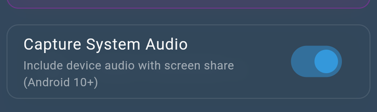<figcaption><p>Android screen sharing can capture system audio on supported Android versions when the source app allows it.</p></figcaption></figure>

#### iPhone and iPad

1. Select **SCREEN** and open **Publishing Settings**.
2. Choose **iOS Screen Share Quality**: **Performance**, **Balanced**, **Quality**, or **Maximum**. **Quality** targets up to 720p; **Maximum** targets up to 1080p when device resources allow it.
3. Connect, select **VDO.Ninja Screen Recorder** in Apple's picker, and tap **Start Broadcast**.
4. Open the app you want to share. Switching to Notes or another app should not end the broadcast.
5. Copy the app-generated viewer link into OBS or a receiving browser.

Screen sharing can include app audio and microphone narration. For narration, enable the microphone in Apple's broadcast controls. The app's microphone mute and **app audio** mute are separate, and unmuting in VDO.Ninja cannot turn on a microphone that is off in Apple's controls. Audio still depends on ReplayKit and the captured app.

For a face-camera inset, enable **Camera overlay** and choose the front or rear camera. It uses a movable system Picture in Picture window that must stay visible. It generally needs iOS 18 or later on iPhone; if it is unavailable, sharing continues without it.

If text is soft, try **Maximum**. If the broadcast freezes or stops, lower the quality and restart. See the [quality modes and limits](../guides/improving-quality-of-the-native-app.md#ios-screen-share-quality). Safari on iOS cannot share another app's screen.

#### Android

Choose **SCREEN**, enable **Capture System Audio** if wanted, and approve Android's screen-capture prompt. On supported Android 14+ devices, pick a single app or the entire screen. System audio needs Android 10+ and permission from the captured app, so not every app allows it.

You can mix microphone narration with system audio. The local microphone mute then controls narration, and a director's audio mute controls the whole outgoing audio track. Background operation is subject to Android's permission and battery rules.

### USB camera

**USB CAMERA** works on Android phones and tablets that support USB host mode. Use a powered USB-C hub for webcams and HDMI capture dongles, and grant Android's USB permission when asked. If the device also carries audio, it may appear in the microphone list.

The iOS app does not support USB cameras, but it can use USB, USB-C, or Lightning audio devices that iOS supports.

<figure>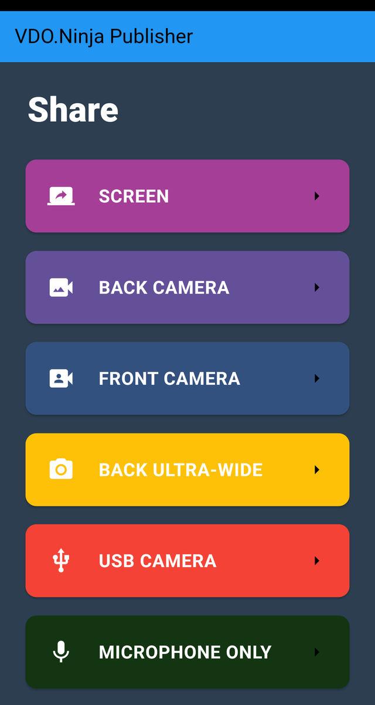<figcaption><p>USB CAMERA appears on Android when the app detects a compatible external camera.</p></figcaption></figure>

<figure>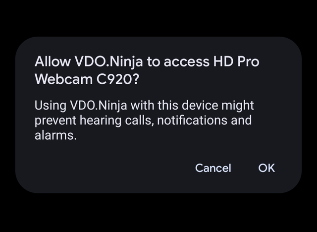<figcaption><p>Android asks for permission before the app can use a connected USB camera.</p></figcaption></figure>

## WHIP publishing

The app can publish to a WHIP endpoint alongside, or instead of, normal VDO.Ninja signaling. Targets include Meshcast, MediaMTX, Cloudflare Stream, Twitch-style WebRTC ingest, and other WHIP services that accept the app's codec and authentication.

<figure>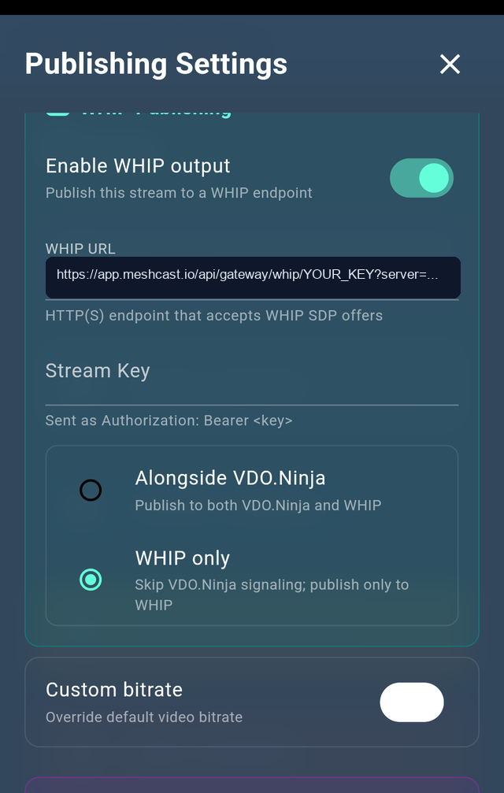<figcaption><p>Enable WHIP output, paste the publish endpoint, and choose whether to publish alongside VDO.Ninja or to WHIP only.</p></figcaption></figure>

| Field | What it does |
| --- | --- |
| **Enable WHIP output** | Turns on WHIP publishing |
| **WHIP URL** | The full HTTPS WHIP publish endpoint |
| **Stream Key** | Optional bearer token, if the provider gives one separately. Leave it blank if the key is in the URL. |
| **Alongside VDO.Ninja** | Publishes to VDO.Ninja and WHIP at once, keeping room and director features |
| **WHIP only** | Skips VDO.Ninja signaling, for a relay, CDN, SFU, or self-hosted server |

```text
Meshcast (anonymous):  https://app.meshcast.io/api/gateway/whip/YOUR_PUBLISH_KEY
MediaMTX-style:        https://media.example.com/mystream/whip
VDO.Ninja WHIP ingest: https://whip.vdo.ninja/YOURTOKENHERE
```

### WHEP viewer source

The app can tell VDO.Ninja viewers to play from a WHEP source when WHIP/WHEP infrastructure handles distribution. Options are **Off**, **Auto**, **Meshcast**, **MediaMTX**, **Cloudflare Stream**, and **Manual WHEP URL**. **Auto** works when the WHIP response includes a matching WHEP playback URL; use **Manual WHEP URL** for a separate playback endpoint.

<figure>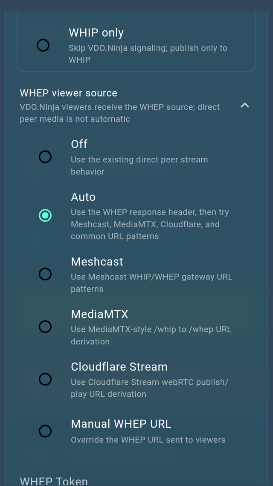<figcaption><p>WHEP viewer source options help VDO.Ninja viewers pull from the WHIP/WHEP host instead of relying only on direct peer-to-peer delivery.</p></figcaption></figure>

### Meshcast WHIP example

Tested with a Pixel 9a, the Android app, a Logitech C920 webcam over USB, and an anonymous Meshcast session:

1. Paste the Meshcast WHIP publish URL into **WHIP URL**, keeping any server hint, and leave **Stream Key** blank:

   ```text
   https://app.meshcast.io/api/gateway/whip/YOUR_PUBLISH_KEY?server=ovh-use1
   ```

2. Select **USB CAMERA** and grant USB permission.
3. To watch, open the matching Meshcast watch, embed, or WHEP URL. Anonymous sessions use the anonymous key as the view path:

   ```text
   https://app.meshcast.io/embed/YOUR_STREAM_KEY?server=ovh-use1
   ```

<figure>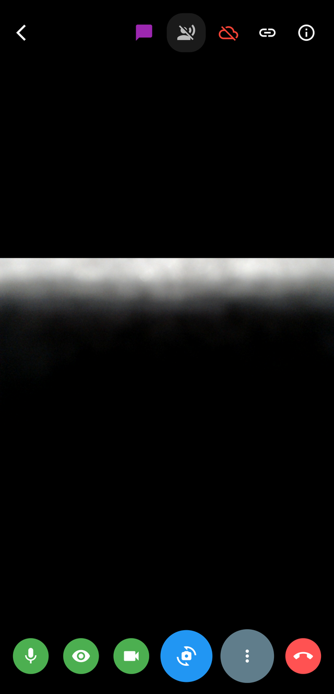<figcaption><p>The live view shows the source preview, connection state, recording state, health overlay, and live controls.</p></figcaption></figure>

<figure>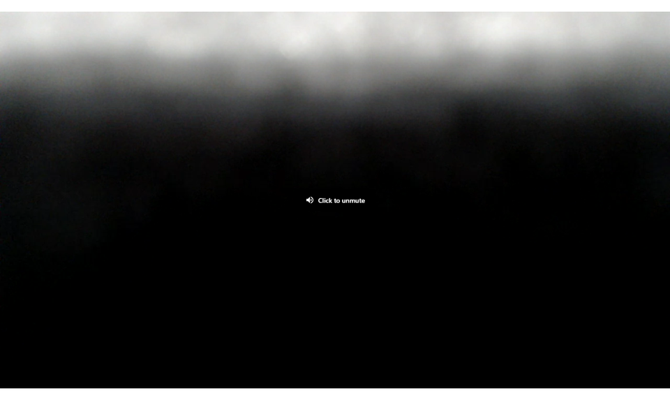<figcaption><p>Meshcast playback receiving the Android USB camera feed via WHIP/WHEP.</p></figcaption></figure>

## Optional RTMP and SRT output

For a direct OBS connection, follow the illustrated [Android SRT guide](../guides/mobile-app/android-srt-to-obs.md) or [iPhone SRT guide](../guides/mobile-app/iphone-srt-to-obs.md).

Android and iOS offer optional experimental RTMP/SRT output. Before starting a supported camera stream, open **Additional outputs**, choose **RTMP** or **SRT**, configure the destination, and enable **Use this destination**. Save, then tap **START STREAM**. While live, use **More → Additional outputs** to start, stop, or retry it. Connection details stay in memory for the current app session.

On older layouts, enable **Advanced Settings → External publishing controls**, start the camera stream, then open **More → Advanced external output**.

* Transports are plain **RTMP** and **SRT caller**. RTMPS and SRTLA are not supported.
* On iOS, it works with single-camera sources, not ReplayKit screen sharing, microphone-only mode, or front/rear mixing.
* On Android, it works with supported video tracks, including camera, USB camera, and screen capture, depending on the device encoder.
* It is an additional H.264/AAC output with its own encoder and bandwidth use.

**Output quality** (called **Advanced encoder settings** in older layouts) sets the output's bitrate, resolution and orientation, frame-rate limit, keyframe interval, H.264 profile, fit/crop, and AAC audio. These do not raise the camera's capture resolution or frame rate. Stop the output before changing them.

iOS also has experimental **Adaptive bitrate (RTMP only)**, off by default. It moves the output bitrate between the selected minimum and maximum as the output queue changes. It does not bond networks or reconnect automatically.

## Audio, recording, and talkback

### USB audio

1. Connect the USB, USB-C, or Lightning audio device before opening Publishing Settings.
2. Select it in the microphone list. Tap **Refresh Mics** if it is missing.
3. Use headphones or echo cancellation if talkback or remote audio is on.

For music, mixers, and professional microphones, test both **Unprocessed Audio** and the **Audio Processing** controls. Unprocessed audio skips echo cancellation, noise suppression, and gain control, so it needs cleaner monitoring.

<figure>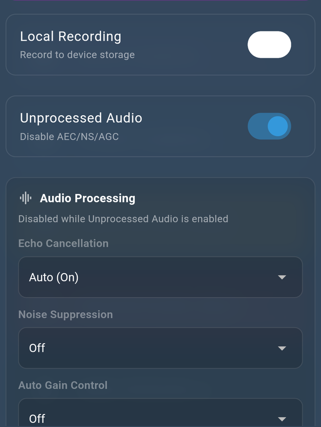<figcaption><p>Recording and audio processing controls are available in Advanced Settings.</p></figcaption></figure>

### Recording

Enable **Local Recording** to save a copy on the device, as a backup or to share later. The live screen shows a recording indicator, and the overflow menu lists recent files. Keep storage free and the phone powered, and test the full recording length before an important event; heat, battery saver, and OS background limits can cut it short. For iOS screen sharing, ReplayKit decides which audio and video are available.

### Talkback

**Remote Audio Stream** plays a VDO.Ninja audio stream on the phone while it publishes, for producer talkback, IFB-style monitoring, program audio, or a cue feed. Enable it, enter the producer's audio-only stream ID if needed, and use headphones. Turn on echo cancellation if you use the phone speaker. Keep talkback out of the program feed unless viewers should hear it.

<figure>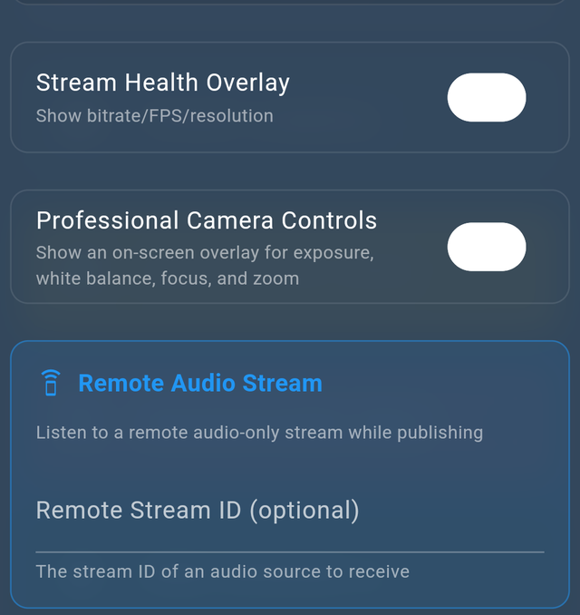<figcaption><p>Remote Audio Stream can bring a separate VDO.Ninja audio feed into the native app while the app is publishing.</p></figcaption></figure>

## Social Stream Ninja

The app can connect to Social Stream Ninja so the camera operator can see chat while filming. In the live view it can show chat, a text-to-speech toggle, and connection state.

<figure>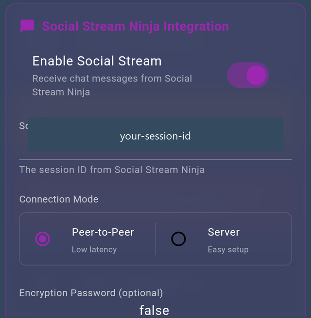<figcaption><p>Enter the Social Stream Ninja session ID, then choose Peer-to-Peer or Server mode.</p></figcaption></figure>

| Setting | What it does |
| --- | --- |
| **Enable Social Stream** | Turns on chat integration |
| **Social Stream Session ID** | The session ID from Social Stream Ninja |
| **Peer-to-Peer** | Lower-latency chat connection |
| **Server** | Easier setup when peer-to-peer is blocked |
| **WebRTC Encryption Password** | Optional password for peer-to-peer mode |

## Live controls

The live screen lets you mute the microphone, hide local video, switch cameras, copy or open a view link, and watch recording and connection status. **More** holds the torch, camera and audio settings, recording, and Android picture-in-picture. Social Stream and Remote Audio Stream controls appear when configured.

Two Advanced Settings options are off until you enable them:

* **Professional Camera Controls** shows supported exposure, white balance, focus, and zoom controls. Built-in cameras also support tap-to-focus where the device allows it. USB camera control depends on the camera, Android device, and UVC support.
* **Stream Health Overlay** shows live bitrate, FPS, resolution, peer count, and connection state.

## Quality, bitrate, and codec

The [quality guide](../guides/improving-quality-of-the-native-app.md) covers these controls and their limits in detail.

* **Bitrate:** for normal camera publishing to VDO.Ninja, request it on the viewer link, for example `https://vdo.ninja/?view=mycamera&videobitrate=6000` (alias `&bitrate`). On Android, **Advanced Settings → Custom bitrate** accepts 100 to 50000 kbps; common defaults are about 6000 kbps for 720p and 10000 kbps for 1080p. iOS relies on the capture preset and WebRTC negotiation. A viewer URL cannot bypass native iOS screen-share limits or reconfigure a WHIP encoder.
* **Minimum video bitrate** (Advanced Settings, both platforms) is a negotiation hint of 50 to 50000 kbps for VDO.Ninja camera streams, applied on the next stream. It is not a guaranteed floor or data cap, and it does not affect WHIP, RTMP, SRT, or native iOS screen sharing.
* **Codec:** start with the default. `&codec=h264` on a direct viewer link requests H.264, which phones often encode in hardware. VP9 and AV1 depend on the app build, device, and receiver. Native iOS screen sharing has a lower-resolution VP8 fallback, so forcing VP8 can make text much softer. WHIP services may restrict codecs, profiles, bitrate, resolution, or frame rate.
* **1080p:** for iOS screen sharing, **Maximum** targets up to 1080p, and **Balanced** and **Quality** up to 720p. Android built-in cameras offer **720p60**, **1080p30**, and **1080p60**, which falls back to 1080p30 when the camera cannot do it. Other modes may show **Prefer 1080p**.
* **Frame rate:** **Advanced Settings → Maximum capture frame rate** sets a ceiling of 1 to 60 fps for the next session. It applies to Android camera, UVC, and screen sources and to iOS cameras, not to native iOS screen sharing.

Higher bitrate is not always better. If quality drops after a few minutes, the usual causes are heat, battery saver, weak WiFi or packet loss, more bitrate than the uplink can carry, too many direct viewers, or an expensive codec. Cool the phone, keep it powered, prefer 5 GHz WiFi or Ethernet, and use WHIP/Meshcast/WHEP fanout when many viewers need the same feed.

## Event checklist

For weddings, ceremonies, panels, lectures, and IRL streams:

1. Test the exact phone, camera, USB adapter, audio device, and network beforehand.
2. Keep the phone on power, use a powered hub for USB video devices, and turn off battery saver.
3. Start at 720p and 30 fps unless the full setup has proven stable at 1080p.
4. Use **WHIP only** when Meshcast or another WHIP service should handle viewer fanout.
5. Watch the remote feed on a second device, test a short local recording, and check talkback with headphones.

## Troubleshooting

| Problem | What to check |
| --- | --- |
| **USB CAMERA** does not appear | It is Android only. Reconnect the camera and restart the app, use a powered hub, check that the camera is UVC compatible, and grant USB permission. |
| USB audio is missing | Connect the device before opening Publishing Settings, then tap **Refresh Mics**. Try another adapter or powered hub. On iOS, reopen Publishing Settings after the OS finishes switching audio routes. |
| Screen share is black or silent | Protected apps may block capture. On Android 14+, share the entire screen instead of one app, and enable **Capture System Audio** only for apps that allow it. On iOS, check app-audio and microphone mutes separately and enable the microphone in Apple's broadcast controls. |
| iOS screen sharing stops | Choose **Balanced** or **Quality** instead of **Maximum** and restart. If the picker was cancelled, end the session and start **SCREEN** again; no screen video is sent until Apple starts the broadcast. |
| WHIP fails to connect | Use an `https://` WHIP publish endpoint, not a watch or WHEP URL. Leave **Stream Key** blank when the key is in the URL. Start a fresh Meshcast anonymous session if the old one expired, use each key from one publisher only, and check the service's codec, token, and URL requirements. |
| Viewers see nothing | Open the matching view, director, Meshcast watch or embed, or WHEP URL, never the WHIP publish URL. Wait a few seconds after the phone connects, use the same server hint on publish and view URLs, and confirm the viewer can reach any WHEP viewer source. |

## Related pages


[native-mobile-app-versions.md](native-mobile-app-versions.md)



[improving-quality-of-the-native-app.md](../guides/improving-quality-of-the-native-app.md)



[how-do-i-control-bitrate-quality.md](../guides/how-do-i-control-bitrate-quality.md)



[bitrate.md](../advanced-settings/video-bitrate-parameters/bitrate.md)



[codec.md](../advanced-settings/view-parameters/codec.md)



[packet-loss.md](../common-errors-and-known-issues/packet-loss.md)



[whip-and-whep-tooling.md](whip-and-whep-tooling.md)



[meshcast.io.md](meshcast.io.md)



[options-to-record-streams.md](../guides/options-to-record-streams.md)



[README.md](social-stream-ninja/README.md)

